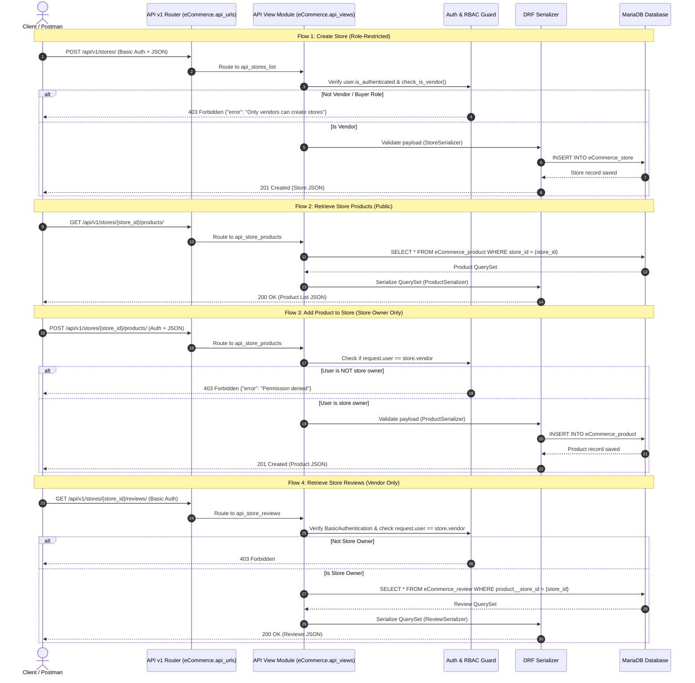

# eCommerce REST API Documentation & Architecture

This document outlines the API specifications, architectural constraints, and interaction sequence diagrams for the eCommerce REST API implementation (Practical Task 1).

---

## 1. Architectural Principles & Data Representations

The API is built using the **Django REST Framework (DRF)** adhering to RESTful architecture constraints and modular design patterns:
* **Decoupled API Architecture:** All REST API controllers are decoupled from server-rendered HTML template views and isolated into `eCommerce/api_views.py`. Endpoint routing is encapsulated in `eCommerce/api_urls.py` under the versioned namespace prefix `/api/v1/`.
* **Statelessness:** No client session state is stored on the server between API requests. Each request carries all necessary authentication headers and data payloads.
* **Uniform Interface & Resource Identification:** Resources (`stores`, `products`, `reviews`) are addressed via predictable, versioned URIs (`/api/v1/...`).
* **Payload Representation:** JSON (JavaScript Object Notation) is used as the primary interchange format for all request bodies and response payloads.
* **Authentication & Permissions:** Sensitive vendor operations require HTTP Basic Authentication (`BasicAuthentication`) and an authenticated user session (`IsAuthenticated`). Store ownership checks ensure vendors can only modify their own resources. Role-based access control (RBAC) ensures only registered vendors and superusers can create storefronts.

---

## 2. Authentication & Headers

| Header | Value | Description |
| :--- | :--- | :--- |
| `Authorization` | `Basic <base64(user:pass)>` | Required on protected endpoints (Vendor/Owner operations) |
| `Content-Type` | `application/json` | Required for all `POST` / `PUT` / `PATCH` payloads |
| `Accept` | `application/json` | Expected response media type |

---

## 3. API Endpoints Overview

| Method | Endpoint | Namespace / Pattern Name | Authorization | Description |
| :--- | :--- | :--- | :--- | :--- |
| **GET** | `/api/v1/stores/` | `ecommerce_api_v1:stores_list` | Public | List all storefronts |
| **POST** | `/api/v1/stores/` | `ecommerce_api_v1:stores_list` | Vendor Only (`403` for Buyers) | Create a new storefront |
| **GET** | `/api/v1/vendors/<vendor_id>/stores/` | `ecommerce_api_v1:vendor_stores` | Public | List stores owned by a specific vendor |
| **GET** | `/api/v1/stores/<store_id>/products/` | `ecommerce_api_v1:store_products` | Public | Retrieve all products belonging to a store |
| **POST** | `/api/v1/stores/<store_id>/products/` | `ecommerce_api_v1:store_products` | Store Owner Only | Add a new product to a store |
| **GET** | `/api/v1/stores/<store_id>/reviews/` | `ecommerce_api_v1:store_reviews` | Store Owner Only | View all reviews for a store's products |

---

## 4. Endpoint Specifications

### 4.1 List All Stores
* **Endpoint:** `GET /api/v1/stores/`
* **Access Level:** Public
* **Response `200 OK`:**
```json
[
  {
    "id": 1,
    "vendor": 1,
    "vendor_username": "admin",
    "name": "Woodstock Tech Hub",
    "description": "Custom hardware, parts, and accessories"
  }
]
```

---

### 4.2 Create Store
* **Endpoint:** `POST /api/v1/stores/`
* **Access Level:** Authenticated Vendor (`Vendors` group or Superuser)
* **Headers:** `Content-Type: application/json`, `Authorization: Basic <credentials>`
* **Request Payload:**
```json
{
  "name": "Woodstock Audio & Tech",
  "description": "High performance speakers and custom cables"
}
```
* **Response `201 Created`:**
```json
{
  "id": 2,
  "vendor": 1,
  "vendor_username": "admin",
  "name": "Woodstock Audio & Tech",
  "description": "High performance speakers and custom cables"
}
```
* **Response `401 Unauthorized`:**
```json
{
  "error": "Authentication credentials were not provided."
}
```
* **Response `403 Forbidden` (Buyer attempted store creation):**
```json
{
  "error": "Forbidden: Only registered vendors can create stores."
}
```
* **Response `400 Bad Request`:**
```json
{
  "name": [
    "This field is required."
  ]
}
```

---

### 4.3 List Stores by Vendor
* **Endpoint:** `GET /api/v1/vendors/<vendor_id>/stores/`
* **Access Level:** Public
* **Response `200 OK`:**
```json
[
  {
    "id": 1,
    "vendor": 1,
    "vendor_username": "admin",
    "name": "Woodstock Tech Hub",
    "description": "Custom hardware, parts, and accessories"
  }
]
```

---

### 4.4 List Store Products
* **Endpoint:** `GET /api/v1/stores/<store_id>/products/`
* **Access Level:** Public
* **Response `200 OK`:**
```json
[
  {
    "id": 1,
    "store": 1,
    "name": "Mechanical Keyboard",
    "description": "Hot-swappable tactile switches with RGB",
    "price": "129.99",
    "stock": 15
  }
]
```

---

### 4.5 Add Product to Store
* **Endpoint:** `POST /api/v1/stores/<store_id>/products/`
* **Access Level:** Authenticated Store Owner Only
* **Headers:** `Content-Type: application/json`, `Authorization: Basic <credentials>`
* **Request Payload:**
```json
{
  "name": "Custom Coiled USB Cable",
  "description": "Double-sleeved aviator connector cable",
  "price": "34.50",
  "stock": 40
}
```
* **Response `201 Created`:**
```json
{
  "id": 2,
  "store": 1,
  "name": "Custom Coiled USB Cable",
  "description": "Double-sleeved aviator connector cable",
  "price": "34.50",
  "stock": 40
}
```
* **Response `401 Unauthorized`:**
```json
{
  "error": "Authentication required to add products."
}
```
* **Response `403 Forbidden` (User does not own store):**
```json
{
  "error": "You do not have permission to modify this store."
}
```
* **Response `400 Bad Request`:**
```json
{
  "price": [
    "A valid number is required."
  ]
}
```

---

### 4.6 Retrieve Store Reviews
* **Endpoint:** `GET /api/v1/stores/<store_id>/reviews/`
* **Access Level:** Authenticated Store Owner Only (`BasicAuthentication` + `IsAuthenticated`)
* **Headers:** `Authorization: Basic <credentials>`
* **Response `200 OK`:**
```json
[
  {
    "id": 1,
    "product": 1,
    "user": 2,
    "rating": 5,
    "comment": "Exceptional build quality and fast shipping!",
    "is_verified": true,
    "created_at": "2026-11-04T12:00:00Z"
  }
]
```
* **Response `401 Unauthorized`:**
```json
{
  "detail": "Authentication credentials were not provided."
}
```
* **Response `403 Forbidden` (Requester does not own the store):**
```json
{
  "error": "Forbidden: You are not the owner of this store."
}
```

---

## 5. Architectural Sequence Diagram


